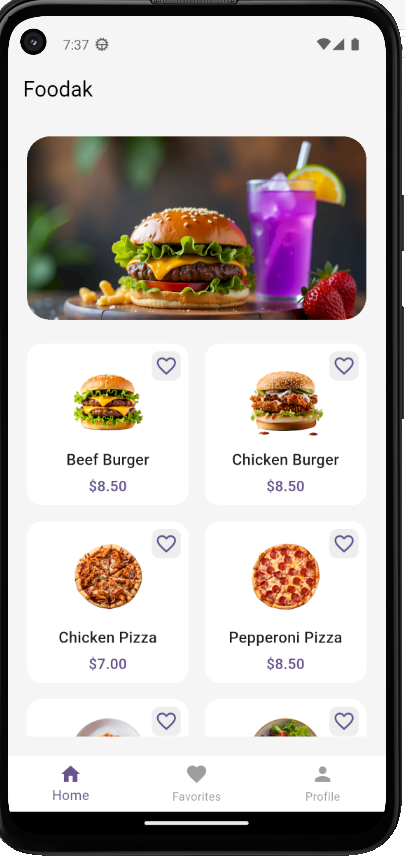
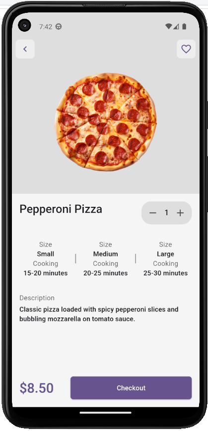
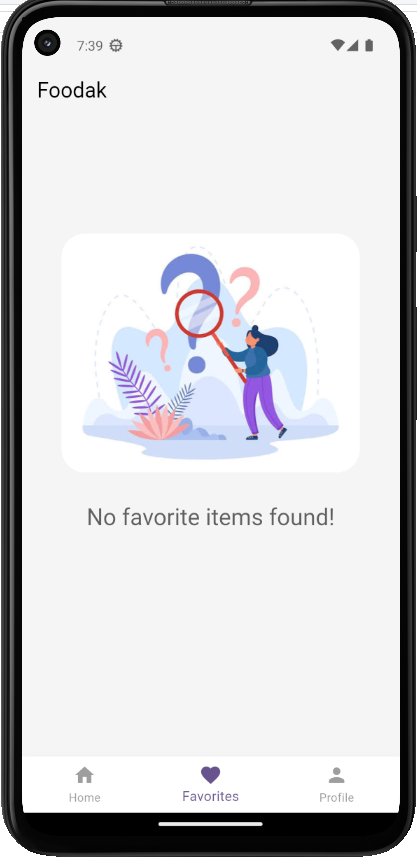
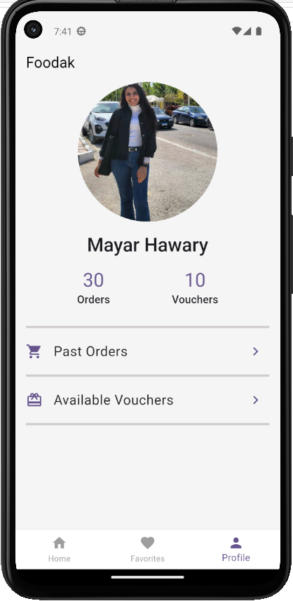
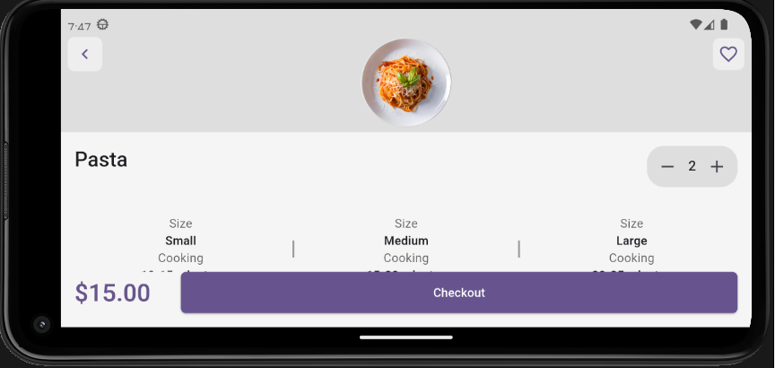

# Food Delivery App

A Flutter app where you browse food items, pick a size, and see the price
update as you change the quantity. I built it as a practice project for
working with multiple screens, reusable widgets, and responsive layouts.

## Screenshots

<p>
  
  
  
  
</p>



## What it does

- Home page with a list of food items
- Details page for each item, with size options and a quantity counter
- Price and total update instantly when you change the size or quantity
- Adding an item shows a small snackbar message
- Favorites page for the items you mark
- Profile page and bottom navigation between the main screens
- Works in landscape mode too

## Built with

Flutter and Dart.

## Project structure

```
lib/
├── models/      # FoodItem, FoodSize
├── pages/       # Home, Details, Favorites, Profile
├── ui_models/   # UI-specific models
├── utils/       # Colors and asset paths
├── widgets/     # Reusable widgets
└── main.dart
```

## Run it locally

```bash
git clone https://github.com/Mayar-Hawary/food-delivery-app.git
cd food-delivery-app
flutter pub get
flutter run
```

## Author

Mayar Hawary · [LinkedIn](https://www.linkedin.com/in/mayar-hawary-73)
